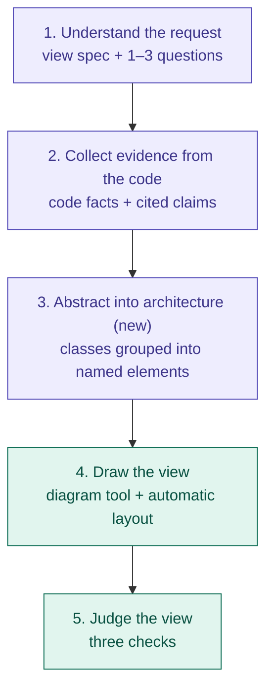
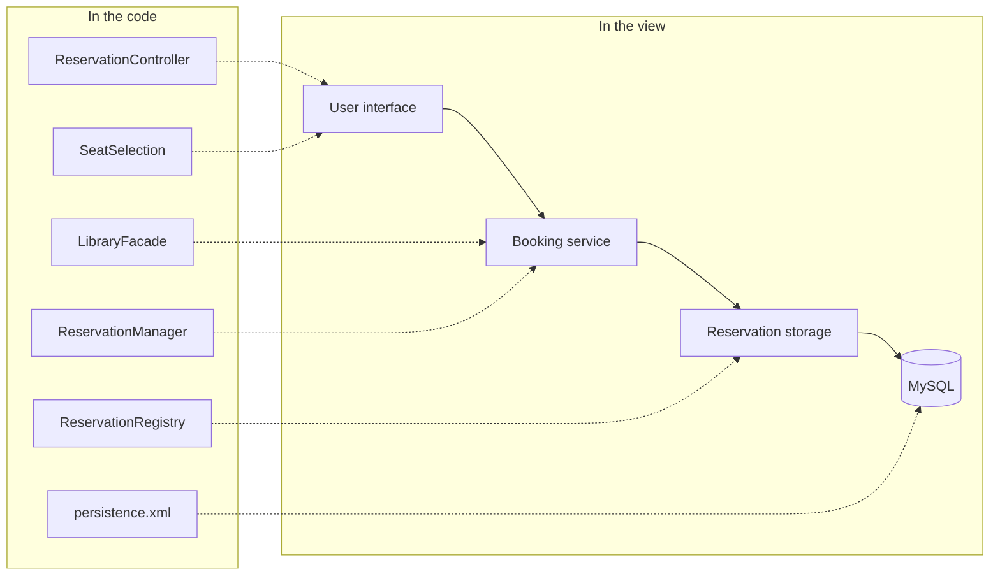
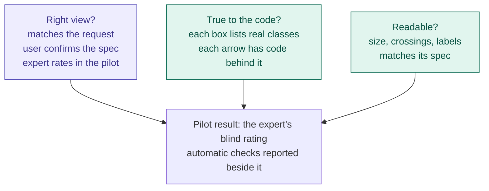

# ADR-007: Architectural views, not code diagrams

- **Status:** accepted and implemented (2026-10-13): steps 1–4 in the pipeline; first live trial in `experiments/adr7-trial/`. Drawing changed by ADR-008 (UML 2.5.1 instead of C4-PlantUML).
- **Builds on:** ADR-006 (evidence model, viewpoint selection, validation)
- **Changes:** ADR-006 D2 (component naming and grain), D3 (projection and the task-fit judge)
- **Evidence:** the pilot (`experiments/pilot-2026-10/`), the CodeToDiagram corpus and studies, and the literature report `reports/Realistic architecture diagram generation.md` (research folder root)
- **Worked example:** [`docs/examples/IS-seat-L1/`](../examples/IS-seat-L1/README.md)

## Problem
The pilot's Task2View views are faithful to the code but are not architectural views:
- **Boxes are classes:** `LibraryFacade`, `StudentFactory`, `ReservationRequestDTO`.
- **Arrows are method calls:** labelled `getInstance`, `findById`; 20–30 of them, crossing.
- **Boxes repeat themselves:** up to 20 near-duplicate responsibility lines in one box.
- **Views repeat each other:** decomposition, client-server and uses show the same boxes.

Real architecture views look different. Of 338 coded open-source views (CodeToDiagram):
- 92% are at module level or coarser;
- classes appear in about 7%;
- 58% use nesting;
- arrows are few and labelled with intent or protocol.

**Root cause:** Task2View never decides what a box and an arrow should be for this request, and has no step that abstracts. It draws what the code offers.

## Decision: five steps, one of them new

Purple: uses an LLM, checked by code. Green: code only.

### D1. Step 1: a view specification, with a short conversation
- Phase 1 turns the request into one spec per view, using the CodeToDiagram vocabulary:
  - concern;
  - scope (whole system or feature slice);
  - behaviour (static or dynamic);
  - granularity (coarse, medium or fine);
  - element nature (clients, APIs, services, layers, technologies, classes);
  - connector nature (request flow, data flow, dependency, deployment);
  - visual language;
  - nesting.
- Viewpoint selection (ADR-006 D1) is kept; the spec says how to draw the chosen viewpoint.
- **Conversation:** ask only where the spec is uncertain, at most 1–3 questions, each with a default (e.g. "only the seat-booking flow, or the whole system?"). Interactive use can also confirm a one-line preview per view. Experiments run without asking, using the defaults, so conditions stay comparable.

### D2. Step 3: abstraction (new)

1. **Code proposes candidates:**
   - runtime parts, databases and technologies come from build, deploy and entry-point facts;
   - roles come from framework conventions (e.g. Spring `@RestController`, `@Service`, `@Repository`; the Django, Express … equivalents);
   - helpers (DTOs, factories, strategies, utilities) attach to the element that uses them.
2. **The LLM groups and names them** at the spec's granularity, e.g. "Booking service", "Reservation storage". Names may now be architectural terms (this replaces ADR-006's names-from-symbols rule).
3. **Each element keeps its member classes.** This is the verification handle.
4. **Arrows are lifted, never invented:**
   - one arrow per pair of elements, drawn only where member classes have code dependencies;
   - type from code (call, data access, event); the LLM adds only a short intent label;
   - dependencies against the layering are shown, marked;
   - relations not drawn are listed.

These rules use framework conventions, not project knowledge, so they generalise across stacks.

### D3. Step 4: draw with a diagram tool
- The intermediate model is a C4-style model: elements with kind, technology, description, parent and members; relationships with intent and protocol. Each view is a selection from that model.
- Render with C4-PlantUML first (closest to today's PlantUML; boundaries, technology labels, legend), then D2 as an alternative.
- Layout comes from the engine: layers top to bottom, nesting, one direction of flow. UML stays where it is the right language: sequence diagrams and the data model.

### D4. Step 5: judging with three questions

- **Right view:** decided by people. In use, the stakeholder confirms the spec. In the pilot, the expert rates each view blind with CodeToDiagram's rubric (Accuracy, Level of Detail, Clarity), so the two studies are comparable.
- **True to the code:** automatic. The members exist, the arrows have code behind them, nothing is invented.
- **Readable:** automatic and measurable:
  - size before layout (Störrle 2014: size correlates with comprehension at r = −0.42);
  - edge crossings;
  - no method names on arrows;
  - short descriptions;
  - title and legend;
  - conformance to the view's spec.

  Numeric thresholds are proposals to calibrate on more than the pilot.
- **The per-theme LLM judge (5 calls per view) is removed from the pipeline.** LLM judges agree poorly with experts (κ ≈ 0.3), and vision models are unreliable on layout.

## Consequences
- Views show 5–12 named elements with their classes behind them, instead of 20+ classes. The example goes from 6 class boxes with method-name arrows to 9 boxes and 10 arrows, with 0 crossings.
- Faithfulness is kept, at element level: members and lifted arrows.
- Fewer model calls: abstraction is one naming call per view, and the judge's 5 calls per view are gone.
- **New risks:**
  - grouping and naming quality (no published metric for names; we define one);
  - framework role catalogues must be maintained per stack;
  - the conversation needs its own evaluation.
- The pilot results stay tied to `pilot-2026-10-frozen`; ADR-007 is evaluated on the same goals with saved evidence first (Phases 5c–8 need no new model calls), then on new goals and repositories.

## Implementation notes (2026-10-13)
- **Code:**
  - `phase5/abstract.py`: scope, roles, parts, naming with checks, connector lifting, coarse grain;
  - `knowledge/data/vb/element_roles.yaml`: role catalogue, evidence checked by strength;
  - `phase7/abstracted.py` and `c4.py`: conversion and C4-PlantUML rendering;
  - `phase1/needs.py`: view spec and clarifications;
  - `phase8/readability.py`: readability and spec rules.

  `run_v2` uses the abstraction step for structural viewpoints; `task2view run --interactive` asks the clarification questions.
- **Size:** part-level views have their own limit (`pipeline.yaml` `abstraction.max_parts`: 7 / 9 / 9, proposed). Over it, a view is drawn by layer.
- **Splits:** the naming step may split a part only into parts that each contain a non-helper class, and only within that limit.
- **The LLM judge** is no longer called by the pipeline. `phase8/judge.py` and `scripts/judge_outputs.py` stay as post-hoc research tools.
- **Superseded by ADR-008 (2026-10-21): every view is UML 2.5.1; the C4 rendering and the per-view notation below were removed.**
- ~~Notation per view (D1/D3, added 2026-10-13):~~ the parts and arrows are shared by every view of a request, but each structural view is drawn in its own notation (`knowledge/data/vb/notations.yaml`, `phase7/arch_notations.py`):
  - technical readers get the notation V&B documents for the viewpoint: decomposition and layered as UML packages in layer rows, uses as UML «use» dependencies with the changed part highlighted, C&C styles as C4 components;
  - overview readers get plain boxes and arrows. A role is an overview reader when its V&B Table 9.1 row asks for no detail in any view of the software's own structure (project manager, customer, end user); roles outside the table state it (`roles.yaml`);
  - the view spec's `notation` (auto, uml, c4, boxes) lets the person ask for a family;
  - Phase 8 checks that the view is drawn in the chosen notation, and the title and legend in that notation.

  Sequence, data-model, deployment and use-case views keep their UML notation.
- **First live trial** (IS-seat-L1, Sonnet 5.5): 8 model calls (15 in the pilot); 7 parts and 7 arrows; 0 crossings; one dependency against the layering found; verdict pass with limitations.

## Implementation order
1. Abstraction (D2), on saved pilot evidence: before/after views for 2–3 goals.
2. C4-PlantUML rendering and the readability checks (D3, D4).
3. View specification and the clarification step (D1).
4. Remove the LLM judge; update the skill, protocol and docs.
