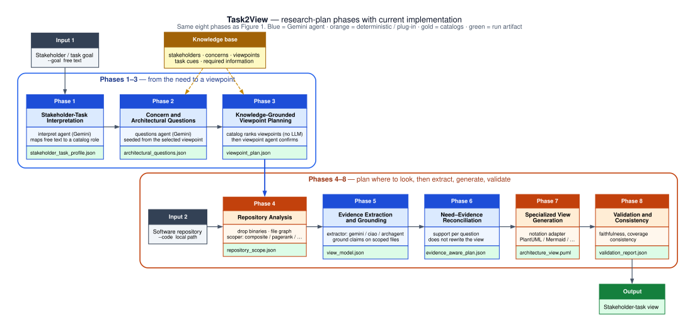

# Pipeline and research-plan phases

## Current pipeline (ADR-006, `task2view run`, default engine `v2`)

Orchestrator: `code/src/task2view/agents/run_v2.py`. Design: [`redesign/01`](redesign/01-knowledge-model.md), [`02`](redesign/02-evidence-and-architecture-model.md), [`03`](redesign/03-views-reconciliation-validation.md); decision: [ADR-006](adr/ADR-006-evidence-model-redesign.md).

| Phase | Module | What runs | Model call? | Artifact |
|---|---|---|---|---|
| 0 Repository card | `phase0/card.py`, `languages/`, `resolve.py`, `facts.py` | Typed files; tree-sitter symbols (Java, Python, JS/TS); directed code-only dependency graph; entry points, entities, deploy/build units, layers; repository signals with evidence | no | `repository_card.json/.txt` |
| 1 Interpretation | `phase1/needs.py` | Needs (primary/secondary), subjects, target, role; every item verified against the goal text; detail level computed | yes | `stakeholder_profile.json` |
| 3 Viewpoint selection | `phase3/selection.py`, `knowledge/catalog.py` | Covering over 30 Views-and-Beyond viewpoints, cap 3; style viewpoints only when the card shows the style; layered overlay; declared gaps | no | `view_plan.json` |
| 2 Questions | `phase2/view_questions.py` | One question per (need, subject) for each selected view, at its grain | no | `architectural_questions.json` |
| 4 Investigation | `phase4/investigate.py` | Tasks per view and subject; starting points from identifiers, entry points, graph neighbours (with origin); optional planning agent restricted to the card | optional | `investigation_plan.json` |
| 5 Evidence | `phase5/agent.py`, `card_tools.py`, `verify.py`, `consolidate.py`, `collect.py` | Tool-using agents produce cited claims; every citation checked (file, lines, excerpt, symbol) and support decided; consolidation into the Architecture Evidence Model | yes | `evidence_model.json` |
| 6 Reconciliation | `phase6/decide.py` | Coverage per question; rule-based decision per view (confirm, simplify, request_evidence, gap, drop); bounded evidence rounds | no | `reconciliation.json` |
| 7 Views | `phase7/project.py`, `notations/` | Deterministic projection to View format v2 (nesting, stereotypes, responsibilities, attributes, ordered interactions, traceability); 9 notations x 10 model kinds | no | `viewset.json`, `V*/view.*` |
| 8 Validation | `phase8/validate_view.py`, `constraints.py`, `judge.py` | Notation compiles; viewpoint constraints; faithfulness to the AEM; coverage; soft task-fit judge (different model) ; bounded repair | judge only | `validation_report.json` |

Limits (task caps, step budgets, repair rounds) are in `knowledge/data/vb/pipeline.yaml`. The legacy pipeline below is still available with `--engine legacy`.

---

## Legacy pipeline (pre-ADR-006, `--engine legacy`)



Source: [`diagrams/architecture.dot`](diagrams/architecture.dot) · raster: [`diagrams/architecture.png`](diagrams/architecture.png).

This is the **same pipeline** as the research plan *From Stakeholder Tasks to Architecture Views* (Figure 1). The boxes keep the plan’s eight phase names. The second line in each box is what `run_agentic` actually runs today.

Two inputs: `--goal` (free-text stakeholder/task) and `--code` (repository). One output: a viewpoint-selected view (`view_model.json` + diagram).

## Plan phase → current implementation

| Plan | Code | What runs today | Artifact |
|---|---|---|---|
| **1** Stakeholder-Task Interpretation | `phase1/interpret.py` | Gemini; role checked against `aliases.yaml`. Concerns are not chosen here. | `stakeholder_task_profile.json` |
| **2** Concern and Architectural Questions | `phase2/questions.py` | Gemini writes concerns and questions from the profile. No viewpoint yet. | `architectural_questions.json` |
| **3** Knowledge-Grounded Viewpoint Planning | `phase3/viewpoint.py` | Gemini chooses one catalog id that can answer those questions, and the diagram language from the registered languages. Grain is looked up afterwards. | `viewpoint_plan.json`, `view_specification.json` |
| **4** Repository Analysis | `phase4/` | File graph and a scoper propose files. The analysis agent writes one task per question, with starting points, candidate files, evidence, grain, and constraints. | `repository_analysis_plan.json`, `repository_scope.json` |
| **5** Evidence Extraction and Grounding | `phase5/evidence.py` | One model call per analysis task that names files. Claims that cite another file are dropped and merged. | `architecture_evidence_model.json`, `view_model.json` |
| **6** Need–Evidence Reconciliation | `phase6/reconcile.py` | Compares each question with the claims and records support, limitations, and unanswered questions. The view is not changed. The diagram language rule is copied onto this plan. | `evidence_aware_plan.json` |
| **7** Specialized View Generation | `phase7/generate.py` | One agent publishes a view using only the recorded evidence, then a notation adapter writes the diagram. | `architecture_view.puml` |
| **8** Validation and Consistency | `phase8/validate.py` | Checks faithfulness, question coverage, and consistency with the grain and the diagram language. Names with no backing are removed. | `validation_report.json`, SVG/PNG/JPEG |

Default orchestrator: `agents/orchestrate.py`. `--skip-extract` stops after Phase 4. `--skip-critic` skips only Phase 6.

Phase 4 writes the analysis plan. The scoper only proposes files. Phase 5 is the only stage that claims what the architecture contains. Phase 3 records why the diagram language was chosen: an explicit request setting, the viewpoint agent's choice, the viewpoint default when the agent names nothing legal, or the formality ladder. A language word in the goal is not scanned.

Typical evaluation command:

```bash
task2view run --code /path/to/repo --goal "…" --out runs/demo \
  --scope-strategy pagerank --extract-backend ciao
```

## What the current runs get right — and what they get wrong

On `pagerank` + `ciao` against the two evaluation repos, **viewpoint choice is often right** and **the drawn boxes are often wrong**. The rows below record those runs, including viewpoints (`scenario`, `module-uses`, `data-model`) that are being removed from the catalog. The catalog that remains is the CIAO section set: `context`, `cnc-runtime`, `module-decomposition`, `code-mapping`, `decision-record`, `allocation-deployment`.

| Goal | Viewpoint chosen | What was drawn | Problem |
|---|---|---|---|
| Tester L1 (registration) | scenario | LibraryFacade, UserManager, UserRegistry, … | This is the one that looks like a view |
| Tester L2 / L3 | module-decomposition / module-uses | L2: `boundary`, `controller`, `dto`, `entity`. L3: 17 boxes / 50 edges | “main components involved” in the goal text beats “integration test”; L3 dumps classes |
| Developer seat L1–L3 | module-decomposition | `Boundary` / `Controller` / `DTO` / `Entity` (packages) | Goal asked for booking, availability, rules, reservations, notification — those types exist (`ReservationManager`, `LibraryFacade`) and were not used as names |
| Architect GR10-Q1 | module-decomposition | Boundary / Control / Database / Entity subsystems | Same package-lift, one lonely edge |
| DevOps GR10-Q2 | allocation-deployment | app container + database | Right kind of view; too thin |
| DBA GR10-Q3 | data-model | Citizen, Report, Location, … | Right kind of view |
| Analyst GR10-Q4 | context | Citizen, Municipal Operator, **Boundary**, Database | System named after a package |

The critic on seat L3 then **endorsed** the package boxes as fully answering “top-level modules and their responsibilities”. Phase 6 is not catching the failure.

So the pipeline shape is the research plan. The remaining defect is not “we picked the wrong diagram kind for DBA/DevOps”. It is: **when the viewpoint is a module view, Phase 5 still publishes folder names, and Phase 6 believes them.**

## What to do next

Items 1–4 below are now in the code (catalog rank, allowed names, folder rebuild, uses arrows, cap, context rename). Remaining:

- **Phase 4** still keeps 16 PageRank files. Force files matching the goal nouns (booking, reservation, registration, notification) before centrality fill.
- **Phase 6** can still praise a weak view. Fail leftover package-shaped names and re-extract once.
- **Deployment views** are still thin (app + database). Seed from Docker/compose/SQL as well as Java.

## Which view for which task

The knowledge base maps stakeholder, task, and concerns to a viewpoint (Phase 3). Examples:

| If the goal looks like… | Viewpoint | What the view should show |
|---|---|---|
| who talks to this system? | context | actors, the system, externals |
| where do I change X? | module decomposition | subsystems named by **responsibility** |
| how do the runtime parts connect? | component-and-connector | containers and connectors |
| what is stored / which types implement it? | code mapping | implementation types and files |
| where does it run? | allocation / deployment | artifacts, nodes, datastores |
| why was it built this way? | decision record | quality attributes and rationale |

Adding a stakeholder or concern is catalog work under `code/src/task2view/knowledge/data/`.

## Architecture decisions

| ADR | Status |
|---|---|
| [ADR-001](adr/ADR-001-agentic-realignment.md) | accepted (extract D5–D7 superseded) |
| [ADR-002](adr/ADR-002-sota-plugins.md) | accepted (D1–D3 superseded by ADR-006) |
| [ADR-003](adr/ADR-003-structure-grounding.md) | superseded in part by ADR-004 |
| [ADR-004](adr/ADR-004-filesystem-graph-and-config.md) | accepted (D2 grouping superseded by ADR-005) |
| [ADR-005](adr/ADR-005-correspondence-and-published-grain.md) | accepted (D1, D4 superseded by ADR-006) |
| [ADR-006](adr/ADR-006-evidence-model-redesign.md) | accepted (design; implementation in progress) |
