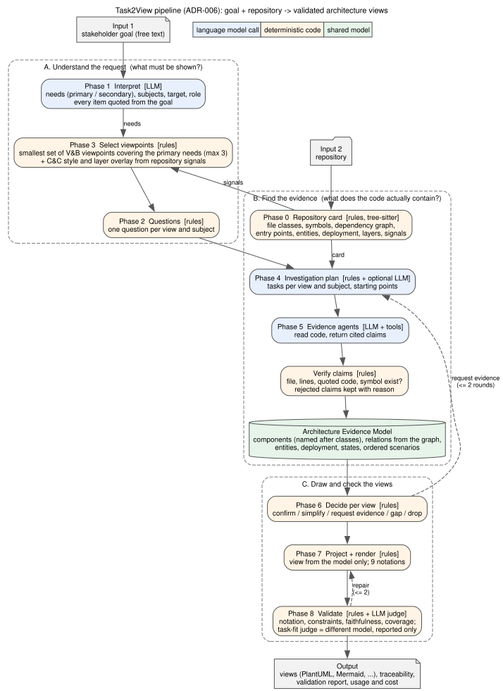

# Pipeline and research-plan phases

## Current pipeline (ADR-006, `task2view run`, default engine `v2`)

Source: [`diagrams/pipeline-v2.dot`](diagrams/pipeline-v2.dot). Blue = language-model call, beige = deterministic code, pink = code plus one naming call (ADR-007 abstraction), green = the shared Architecture Evidence Model. Interactive version with details per step: https://sa4s-serc.github.io/task2View/comparison/#pipeline

Orchestrator: `code/src/task2view/agents/run_v2.py`. Design: [`redesign/01`](redesign/01-knowledge-model.md), [`02`](redesign/02-evidence-and-architecture-model.md), [`03`](redesign/03-views-reconciliation-validation.md); decision: [ADR-006](adr/ADR-006-evidence-model-redesign.md).

| Phase | Module | What runs | Model call? | Artifact |
|---|---|---|---|---|
| 0 Repository card | `phase0/card.py`, `languages/`, `resolve.py`, `facts.py` | Typed files; tree-sitter symbols (Java, Python, JS/TS); directed code-only dependency graph; entry points, entities, deploy/build units, layers; repository signals with evidence | no | `repository_card.json/.txt` |
| 1 Interpretation | `phase1/needs.py` | Needs (the concern-level questions; primary/secondary), subjects, target, role; view spec (scope, granularity, behaviour) with up to 3 clarification questions (defaults unless `--interactive`); every item verified against the goal text; detail level computed | yes | `stakeholder_profile.json` |
| 3 Viewpoint selection | `phase3/selection.py`, `knowledge/catalog.py` | The one Views-and-Beyond viewpoint (drawn as a UML diagram type, ADR-008) that best covers the needs; style viewpoints only when the card shows the style; layered overlay; declared gaps | no | `view_plan.json` |
| 2 Questions | `phase2/view_questions.py` | One question per (need, subject) for each selected view: the need refined at the viewpoint's grain | no | `architectural_questions.json` |
| 4 Investigation | `phase4/investigate.py` | Tasks per view and subject; starting points from identifiers, entry points, graph neighbours (with origin); optional planning agent restricted to the card | optional | `investigation_plan.json` |
| 5 Evidence | `phase5/agent.py`, `card_tools.py`, `verify.py`, `consolidate.py`, `collect.py` | Tool-using agents (older results elided, prompt prefix cached; or `--evidence retrieval`, one call over seed code, as baseline) produce cited claims; every citation checked (file, lines, excerpt, symbol) and support decided; consolidation into the Architecture Evidence Model (package components for overview goals, class anchors otherwise; relations marked convergence / divergence / absence) | yes | `evidence_model.json` |
| 7 Views | `phase5/abstract.py`, `phase7/abstracted.py`, `uml_arch.py`, `uml_rules.py`, `project.py`, `notations/plantuml.py` | Structural views: named parts with their classes, arrows lifted from code (ADR-007), drawn as UML package or component diagrams; other views: deterministic projection to View format v2 (nesting, stereotypes, responsibilities, attributes, ordered interactions, traceability). Every view is UML 2.5.1 in PlantUML, with the Annex A frame heading (ADR-008) | no | `viewset.json`, `V*/view.puml` |
| 8 Checks | `phase8/validate_view.py` | The diagram compiles; every mark is backed by verified code (faithfulness to the evidence model). No LLM judge, no repair loop | no | `validation_report.json` |

Limits (task caps, step budgets) are in `knowledge/data/vb/pipeline.yaml`. The pre-ADR-006 pipeline was removed (git history before `befee66`); its decisions are recorded in ADR-001 to ADR-005.

## Architecture decisions

| ADR | Status |
|---|---|
| [ADR-001](adr/ADR-001-agentic-realignment.md) | historical (pre-ADR-006 pipeline) |
| [ADR-002](adr/ADR-002-sota-plugins.md) | superseded by ADR-006 |
| [ADR-003](adr/ADR-003-structure-grounding.md) | historical |
| [ADR-004](adr/ADR-004-filesystem-graph-and-config.md) | historical |
| [ADR-005](adr/ADR-005-correspondence-and-published-grain.md) | phase order kept by ADR-006; rest superseded |
| [ADR-006](adr/ADR-006-evidence-model-redesign.md) | accepted, implemented |
| [ADR-007](adr/ADR-007-architectural-views.md) | accepted: view specification, abstraction step, diagram-tool rendering, three-question judging (worked example: [`examples/IS-seat-L1`](examples/IS-seat-L1/README.md)) |
