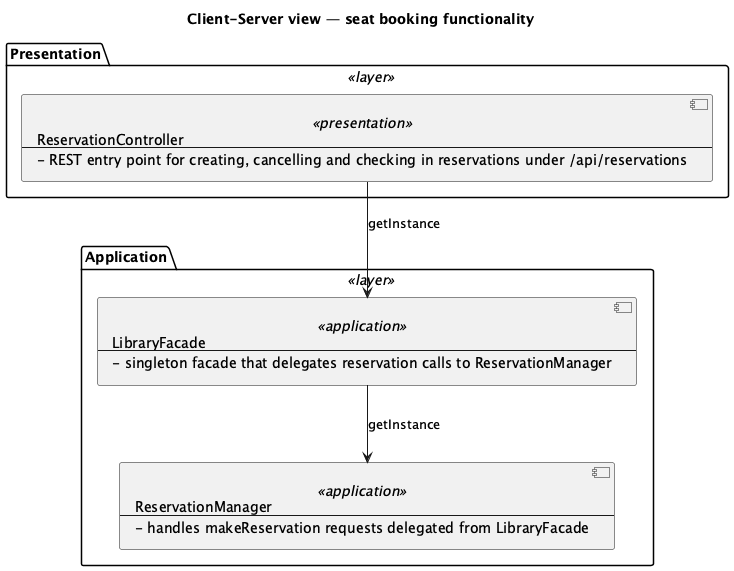
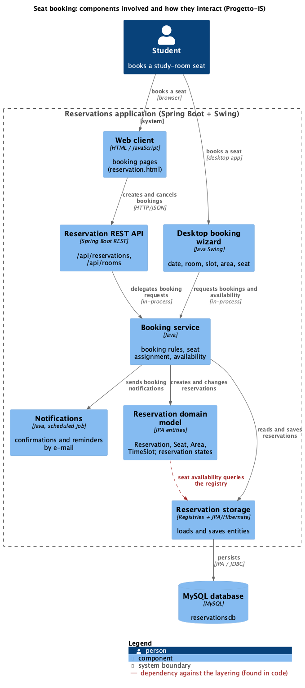

# Worked example: IS-seat-L1 under ADR-007

Hand-built to show what ADR-007 should produce. Every element and arrow was checked against the Progetto-IS repository card from the pilot (`experiments/pilot-2026-10/outputs/task2view/IS-seat-L1/repository_card.json`); nothing was generated by a model.

**Request:** "I am a software developer. I need to modify the seat booking functionality and understand the main system components involved and how they interact."

| Before: pilot output (frozen pipeline) | After: ADR-007 example |
|---|---|
|  |  |

## Step 1: view specification
From `elements.json` (`view_spec`):

| Field | Value |
|---|---|
| Concern | where a change to seat booking belongs and what it touches |
| Scope | feature slice: seat booking |
| Behaviour | static, with the request flow as arrows |
| Granularity | medium: roles and runtime parts, not classes |
| Element nature | clients, API, services, domain, data access, database |
| Connector nature | request flow and data access, labelled with intent and protocol |
| Visual language | boxes and arrows (C4-PlantUML), layers top to bottom |

No clarification question was needed: the request names one feature and asks for components and their interaction. Had it said only "seat booking", the tool would ask: "Only the parts involved, or also the order of calls?"

## Step 3: abstraction
Eight elements; each keeps its member classes (48 classes in total, all present in the code). See `elements.json` for the full lists.

| Element | Members (examples) | How it was found |
|---|---|---|
| Web client | `reservation.html`, `app.js` | web files that call `/api/...` |
| Desktop booking wizard | `DateAndRoomSelection`, `TimeSlotSelection`, `AreaSelection`, `SeatSelection`, `ReservationSummary` (7) | Swing screens of the booking flow |
| Reservation REST API | `ReservationController`, `StudyRoomController`, `RestExceptionHandler` | HTTP entry points (`@RestController`) |
| Booking service | `LibraryFacade`, `ReservationManager`, `StudyRoomManager`, the seat-assignment strategy, booking DTOs (11) | classes the entry points call; DTOs attached to their user |
| Notifications | `NotificationManager`, `NotificationScheduler`, `ExternalEmailGateway` (6) | scheduled job and e-mail adapter |
| Reservation domain model | `Reservation`, `Seat`, `Area`, `TimeSlot`, the reservation states (16) | JPA entities and the State pattern |
| Reservation storage | `ReservationRegistry`, `StudyRoomRegistry`, `UserRegistry`, `PersistenceManager`, `JpaUtil` | registries and JPA access |
| MySQL database | `reservationsdb` | `persistence.xml` JDBC URL |

## Arrows: lifted from code, not invented
All code dependencies between members (imports excluded), merged per pair of elements:

| From → to | Code dependencies | Drawn as |
|---|---|---|
| Booking service → domain model | 141 | "creates and changes reservations" |
| Booking service → storage | 44 | "reads and saves reservations" |
| Storage → domain model | 38 | not drawn: storage returning entities is implied |
| Desktop wizard → booking service | 36 | "requests bookings and availability" (in-process) |
| Notifications → domain model | 23 | not drawn: secondary to the question |
| REST API → booking service | 12 | "delegates booking requests" (in-process) |
| Booking service → notifications | 10 | "sends booking notifications" |
| **Domain model → storage** | **9** | **dashed red: `Seat` checks availability by calling `ReservationRegistry`**, a dependency against the layering a developer changing booking should know |
| Notifications → storage / booking | 3 / 2 | not drawn: minor |
| Web client → REST API | (web file) | "creates and cancels bookings" (HTTP/JSON): `reservation.html:385` posts to `/api/reservations/create` |
| Storage → MySQL | (deploy fact) | "persists" (JPA/JDBC) |

Relations left out are listed in the view's notes, never silently dropped.

## Step 5: the three checks
- **Right view?** Matches the spec (feature slice, roles not classes, request flow). In the pilot, the expert judges it blind.
- **True to the code?** All 48 members exist; every drawn arrow has code dependencies (or a web/deploy fact) behind it; no element without members except the web client (files) and database (deploy fact).
- **Readable?** 9 boxes, 10 arrows, 0 crossings, one line per description, no method names on arrows, title and legend present.

## Files
- `elements.json`: the view spec and the element-to-class mapping.
- `view.puml` / `view.png`: the rendered view (C4-PlantUML, rendered locally).
